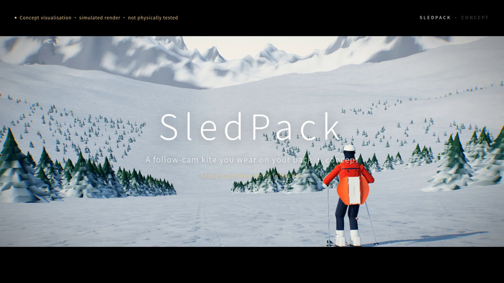

# FlySelfie — a camera kite that lives on your back

**English** · [简体中文](README.zh-CN.md)

> Ski off, and a tiny kite lifts off your back and films you from above.
> Stop, and it comes back down. No drone pilot, no selfie stick, no friend behind you.
>
> That's the idea. This repo is where we're finding out whether physics agrees, in the open.



<sub>Frame from the concept film: a **simulated render, not real footage**. Nothing in this repo has been built or flown yet.</sub>

---

## What is it?

**FlySelfie** is an open research project for a *solo, hands-free follow-camera*. It films you doing your sport, and you never have to stop to fly it, hold it or ask a friend. Our current lead concept is **SledPack**:

- **A soft, unpowered sled kite** (0.20 m², about 71 g with its camera pod) that rides **open and flat on your back**. There is no pole and no boom.
- **A slim pack with all the brains and motors in it.** A two-drum reel holds the main line and a "depower" line, and IMU + GNSS detect when you start moving.
- **It launches itself** when you're moving and there's enough airflow. The kite drops into your wake and climbs; filming starts after about 2 s (simulated median).
- **It flies higher and farther as you go faster.** Line length follows the apparent wind, from 5 to 9 m, at about 56° elevation, and a swing guard reels in when the kite drifts to the side.
- **It stays a kite.** All actuation is in the pack and the flyer carries no motor, which matters a great deal for regulations.

Skiing is the demanding example we design and simulate against. The same idea *might* work for running, cycling, motorcycling, boating or driving on closed tracks. Those uses are **not evaluated yet**, and local road and airspace rules apply. That's part of why we want your help.

## Why it's interesting

- **Gravity and airflow do the work.** Your own motion supplies the wind, so the flyer needs no propeller. The battery mostly runs the camera, giving about 49 min at −10 °C in simulation.
- **It's a genuinely open design problem.** Kite aerodynamics, tether dynamics, wake turbulence, estimation and control, computational camera framing, human factors and safety all meet in one small product.
- **We publish the failures too.** Every concept is judged against the same 13 criteria in a shared simulator, in 48 wind cases. Independent reviews have repeatedly overturned our own optimistic numbers.

## The journey so far

| Round | What we tried | What we learned |
|---|---|---|
| 1 | 36 concepts (drones, poles, sleds, kites, computational imaging…) → 3 finalists | Body-worn cameras can't give a true third-person view, and snow-surface robots are too dangerous. |
| 2–4 | Original concepts: drogue kite K2, "leapfrog" gravity glider, towed glider, descent glider | The leapfrog glider was the only one marginally usable in simulation. The kites suffered from the line hanging low behind the rider (a "clothesline"), the line across the frame, and tailwinds. |
| AT-1 | An active-reel tethered glider: auto pay-out, pumping and docking | "Fly it like a kite" works for slow line management, not for fast control. It failed impact energy (57 J) and head clearance. |
| SledPack v1 | Pole-free spine sleeve, soft sled kite, pack-side depower line | 8 of 13 criteria passed. Geometry proved that **any** pole-free exit puts the line within about 1 m of the head. |
| SledPack v2 | User-led UX pivot: the open kite rides on your back, the line exits from a hip-belt eyelet, line length follows speed and wind | 8 of 13 criteria passed. No contact with the head, and the line is ≥1 m from the head in steady flight. Still open: tailwind swing, re-docking and footage share. |

The full story is in **[docs/en/overview.md](docs/en/overview.md)**; the original Chinese record is in [docs/20-concept-selection-zh.md](docs/20-concept-selection-zh.md).

## Honest status: SledPack v2.1 (simulation only)

These results come from uncalibrated numerical simulation (`sim/js/concepts/sledpack`) over 48 wind cases. Full report: [research/sledpack_2026_10_21/dev/REPORT.md](research/sledpack_2026_10_21/dev/REPORT.md).

| ✅ Passing in simulation | ❌ Still open |
|---|---|
| Worn mass 0.62 kg (design estimate) | Usable footage 48 % of riding (target ≥80 %); about 20 % in tailwinds |
| Launch → filming 1.9 s (median); 100 % launch success (assumed release-from-back and wake models) | In tailwind or strong crosswind, the line comes within 1 m of the head for up to 21 % of riding (target ≤5 %) |
| 0 hand actions while moving | Picture shake 6.5 °/s (target ≤3) |
| Peak pull on the body ≤36 N (depends on the wake model) | It usually parks on the snow and relaunches, rather than re-docking onto your back; a parked kite and line can be skied over |
| 49 min of filming at −10 °C (≈37 min at expert speeds) | The line is below 2 m behind the rider about 55 % of the time, a trip risk for others |
| Strike energy 13.6 J (limit 14.9; fails for 15–17 m/s riders and at +10 % kite mass) | Doesn't fly in tailwinds above about 5 m/s |
| No head contact (closest 0.49 m); each close pass ≤1.9 s (both depend on the wake/release models) | **No physical prototype or test yet** |

## See it

- 🎬 **Concept films (zh / en)** — attached to the GitHub Release `v0.1.0-concept`, and online at
  [English](https://blind.pub/flyski/media/sledpack_promo_en.mp4) · [中文](https://blind.pub/flyski/media/sledpack_promo_zh.mp4).
  Every frame is labelled "concept visualisation · simulated render · not physically tested".
- 🧪 **Concept lab (live)**: https://blind.pub/flyski/concepts.html shows every concept with physics, test cases, metrics and animated use cycles.
- 🛠️ **Original kite simulator**: https://blind.pub/flyski/

| | |
|---|---|
|  |  |
|  |  |

## Quick start

The simulator is plain ES modules with no build step and no runtime dependencies. You need Node ≥ 20.

```bash
git clone https://github.com/ChuangLee/flyselfie.git
cd flyselfie/sim
npm start            # serves on http://localhost:8080  (index.html, concepts.html)
npm test             # solver, concept and i18n tests (takes several minutes)
npm run gen-reference  # regenerate reference data after changing the main solver
```

The promo film renders with `python3 sim/tools/render_promo.py` (Playwright Chromium + ffmpeg); see [research/sledpack_2026_10_21/video/README.md](research/sledpack_2026_10_21/video/README.md).

## Repository map

```
sim/                    browser simulator + concept lab (three.js vendored, no build)
  js/concepts/common/   shared physics & judging: skier, wind, criteria, 48-case full run
  js/concepts/<id>/     one folder per concept (sledpack, activetether, leapfrog, kite2, …)
  tests/                node --test suites
docs/                   design docs (zh + en), media, overview
research/               every study round: briefs, scripts, results, independent reviews
project/plan.json       project plan (single source of truth) + plan.py tool
output/                 generated reports and film stills (films → Releases)
```

Indexes: [docs/README.md](docs/README.md) · [research/README.md](research/README.md)

## 🙌 Help build it

We're looking for kite flyers, aero and controls people, embedded engineers, camera and computer-vision folks, skiers, runners and anyone who likes hard, honest engineering problems. Good places to start:

- **Tailwind swing:** cut the episodes where the kite swings behind the head in tailwind or crosswind, without adding a pole. Steering, bridle design or control laws are all fair game.
- **Auto re-dock:** get the kite back onto the back when the rider has stopped and there's no airflow.
- **Picture shake:** bring jitter from 6.5 to ≤3 °/s, for example with better reframing or tracking, or a lighter stabiliser.
- **Rider wake:** replace our ASSUMED wake model with CFD or measured data.
- **Sled-kite aerodynamics:** measure or find a polar, collapse limits and flag-out behaviour for small single-skin sleds.
- **Other sports:** model running, cycling or motorcycling (apparent wind, line hazards, legality). These are unevaluated today.
- **Physical prototypes:** the 11 tests listed in the [SledPack report](research/sledpack_2026_10_21/dev/REPORT.md). Please share data, even negative results.
- **Simulator and UX:** better rider model, faster rendering, mobile layout, translations.

Read **[CONTRIBUTING.md](CONTRIBUTING.md)** ([中文](CONTRIBUTING.zh-CN.md)) and open an issue: an idea, a bug, a counter-argument or a measurement are all welcome.

## Disclaimer

This is a **concept and an uncalibrated simulation**. Nothing has been built, flown or tested with users, and no physical test has been run. The films and images are **simulated renders, not real footage**. Flying a tethered kite near people, roads, ski lifts or power lines can be dangerous and may be illegal. Airspace, road and resort rules vary by location. Don't try this on a public road or a crowded slope.

## License

- **Code:** [MIT](LICENSE).
- **Images in `docs/media/` and the concept films:** [CC BY 4.0](docs/media/LICENSE.md).
- **Third-party:** three.js (MIT) and Poly Haven textures (CC0); see [sim/assets/README.md](sim/assets/README.md).
