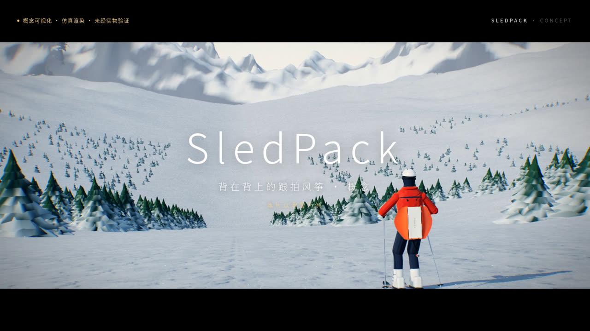
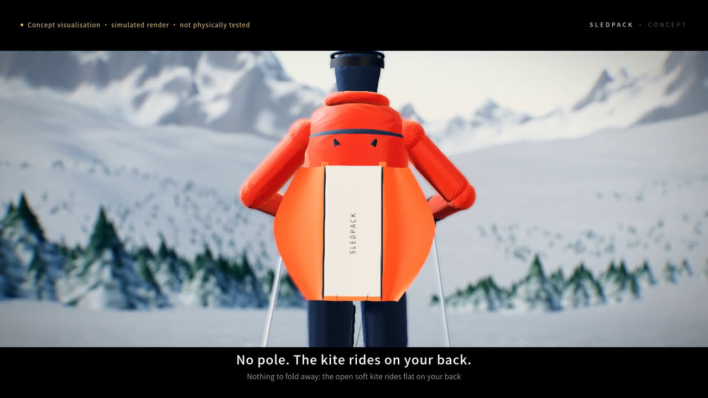
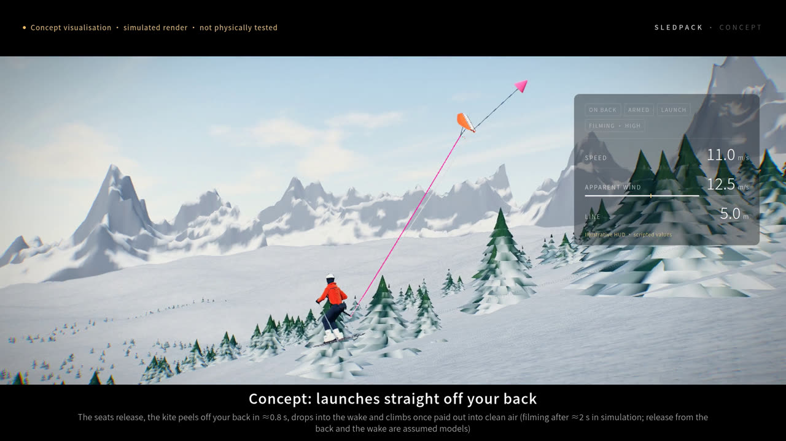
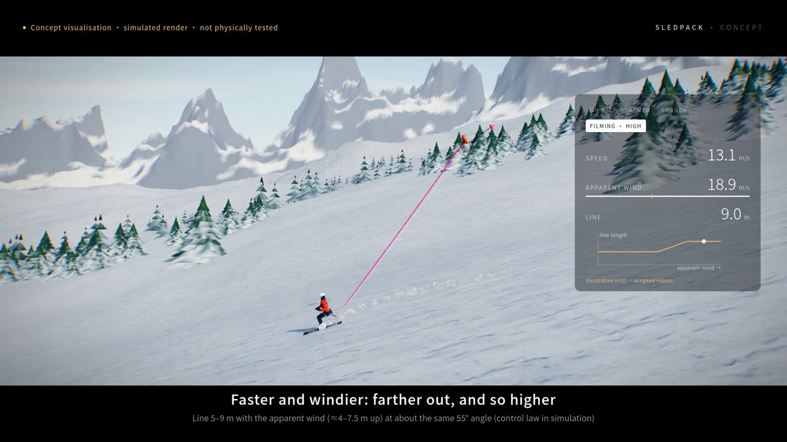
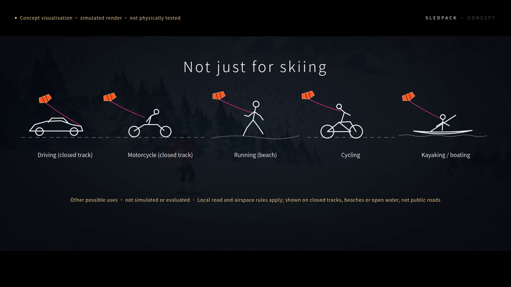

# FlySelfie：住在你背上的跟拍风筝

[English](README.md) · **简体中文**

> 滑出去，一只小风筝从背上升起，从空中拍你；
> 停下来，它就落回来。不用操控无人机，不用自拍杆，也不用朋友跟在后面。
>
> 这是我们的设想。这个仓库公开记录：物理是否同意。



<sub>概念片画面：**仿真渲染，不是实拍**。本仓库中的任何东西都还没有造出来、也没有飞过。</sub>

---

## 这是什么？

**FlySelfie** 是一个开源研究项目，目标是**单人、免手的自动跟拍相机**：你专心运动，不用停下来起飞、手持或请朋友帮忙。当前主方案叫 **SledPack**：

- **无动力软翼风筝**（0.20 m² sled，含相机吊舱约 71 g）。不用时**展开平贴在背上**，没有杆，也没有悬臂；
- **轻薄背包装下全部“大脑”和电机**：双卷轴（主线 + 泄力线），惯导 + 卫星定位判断你已经开始运动；
- **自动起飞**：在运动中且相对气流足够时，风筝落入你身后的尾流再爬升，约 2 s 开始拍摄（仿真中位数）；
- **越快飞得越高越远**：线长随视风在 5–9 m 之间调整，仰角约 56°；风筝偏到侧面时“防摆”自动收线；
- **始终是风筝**：所有执行机构都在背包里，飞行体不带电机，这对法规定性很重要。

本片和本仓库以**滑雪**为严苛场景来设计和仿真。同样的思路*或许*也适用于跑步、骑行、摩托、划船或封闭场地驾驶，但**尚未评估**，并且必须遵守当地道路与空域规定。这正是我们需要你一起参与的原因之一。

## 为什么有意思

- **风和重力干活**：你自身的运动提供气流，飞行体不需要螺旋桨。电池主要供相机使用，仿真中 −10 °C 下约 49 min。
- **一个真正开放的工程难题**：风筝气动、系绳动力学、尾流湍流、估计与控制、计算构图、人因与安全，都集中在一个小产品上。
- **失败也公开**：每个方案都在同一个共享仿真器中，按同样 13 项判据、48 种风况评判；独立复核多次推翻过我们自己偏乐观的数字。

## 一路走来

| 轮次 | 尝试 | 结论 |
|---|---|---|
| 1 | 36 个构想（无人机、杆、雪橇、风筝、计算成像……）→ 3 个入选 | 身上的相机拍不到真正的第三人称视角；雪面机器人太危险 |
| 2–4 | 原创：减速伞风筝 K2、“蛙跳”重力滑翔、拖曳滑翔、抛飞滑翔 | 只有蛙跳在仿真中勉强可用；风筝的问题是线在骑手身后低悬（“晾衣绳”）、线横穿画面，以及顺风 |
| AT-1 | 主动收放线系留滑翔：自动放线、泵升、回收停靠 | “像放风筝一样收放线”适合慢速线长管理，不适合快速控制；动能 57 J、头部净距不过 |
| SledPack v1 | 无杆脊柱套管 + 软翼 + 背包泄力线 | 13 项中 8 项通过；几何证明：**任何**无杆出线口都会让线进入头部 1 m 以内 |
| SledPack v2 | 以体验为先（用户决定）：展开背负、腰带后环出线、线长随速度和风变化 | 13 项中 8 项通过；不碰头，稳定飞行时线离头 ≥1 m；仍待解决：顺风摆动、回背停靠、可用画面比例 |

完整经过见 **[docs/zh/overview.md](docs/zh/overview.md)** 与 [docs/20-concept-selection-zh.md](docs/20-concept-selection-zh.md)。

## 当前状态：SledPack v2.1（仅仿真）

以下来自未经标定的数值仿真（`sim/js/concepts/sledpack`），48 种风况。完整报告：[research/sledpack_2026_10_21/dev/REPORT.md](research/sledpack_2026_10_21/dev/REPORT.md)。

| ✅ 仿真中达标 | ❌ 仍待攻克 |
|---|---|
| 背负 0.62 kg（设计估算） | 可用画面占滑行时间 48%（目标 ≥80%），顺风约 20% |
| 起飞到开拍中位 1.9 s；起飞成功率 100%（背上脱离与尾流为假设模型） | 顺风或强侧风时，线进入头部 1 m 以内最多占骑行时间 21%（目标 ≤5%） |
| 滑行中 0 次手动操作 | 画面抖动 6.5 °/s（目标 ≤3） |
| 对身体拉力 ≤36 N（依赖尾流模型） | 停下后多半停在雪上再起飞，很少自动回到背上；停在雪上的风筝和线可能被他人压到 |
| −10 °C 拍摄 49 min（高手速度约 37 min） | 约 55% 的时间线在骑手身后低于 2 m，可能绊倒他人 |
| 撞击动能 13.6 J（限值 14.9；15–17 m/s 的高手或风筝重 10% 时超限） | 顺风超过约 5 m/s 不起飞 |
| 不碰头（最近 0.49 m）；每次近距离经过 ≤1.9 s（均依赖尾流/脱离模型） | **尚无实物样机与实测** |

## 看一看

- 🎬 **概念片（中/英）**：附在 GitHub Release `v0.1.0-concept`，也可在线观看：
  [中文](https://blind.pub/flyski/media/sledpack_promo_zh.mp4) · [English](https://blind.pub/flyski/media/sledpack_promo_en.mp4)。每一帧都标注“概念可视化 · 仿真渲染 · 未经实物验证”。
- 🧪 **方案实验室（在线）**：https://blind.pub/flyski/concepts.html，含每个方案的物理模型、测试工况、指标和完整使用循环动画。
- 🛠️ **早期风筝仿真器**：https://blind.pub/flyski/

| | |
|---|---|
|  |  |
|  |  |

## 快速开始

仿真器是纯 ES 模块，无需构建，也没有运行时依赖，需要 Node ≥ 20。

```bash
git clone https://github.com/ChuangLee/flyselfie.git
cd flyselfie/sim
npm start            # http://localhost:8080 （index.html、concepts.html）
npm test             # 求解器、方案与多语言测试（需数分钟）
npm run gen-reference  # 修改主求解器后重新生成参考数据
```

概念片渲染命令为 `python3 sim/tools/render_promo.py`（需要 Playwright Chromium 和 ffmpeg），见 [research/sledpack_2026_10_21/video/README.md](research/sledpack_2026_10_21/video/README.md)。

## 仓库结构

```
sim/                    浏览器仿真器 + 方案实验室（内置 three.js，无构建）
  js/concepts/common/   共享物理与判据：滑雪者、风场、判据、48 例全程
  js/concepts/<id>/     每个方案一个目录（sledpack、activetether、leapfrog、kite2……）
  tests/                node --test 测试
docs/                   设计文档（中/英）、图片、总览
research/               每一轮研究：任务书、脚本、结果、独立复核
project/plan.json       项目计划（唯一事实来源）+ plan.py 工具
output/                 生成的报告与影片截图（影片放在 Releases）
```

索引：[docs/README.md](docs/README.md) · [research/README.md](research/README.md)

## 🙌 一起来造

欢迎风筝玩家、气动与控制工程师、嵌入式工程师、相机与视觉开发者、滑雪者、跑者，以及所有喜欢硬核又诚实的工程问题的人。可以从这些地方入手：

- **顺风摆动**：在不加杆的前提下，减少顺风或侧风时风筝摆到头后方的情况。转向、拉线设计、控制律都可以。
- **自动回背停靠**：骑手停下、没有气流时，怎么把风筝收回背上？
- **画面抖动**：把抖动从 6.5 降到 ≤3 °/s，例如改进重构图或跟踪，或用更轻的稳定器。
- **骑手尾流**：用 CFD 或实测数据替换目前假设的尾流模型。
- **小型单层 sled 风筝气动**：测量或查找极曲线、塌翼极限和泄力（飘旗）特性。
- **其他运动**：为跑步、骑行、摩托建模（视风、绳的危险、合法性），目前尚未评估。
- **实物样机**：[SledPack 报告](research/sledpack_2026_10_21/dev/REPORT.md)中列出的 11 项实测。欢迎分享数据，负面结果也很有价值。
- **仿真器与体验**：更好的人物模型、更快的渲染、移动端布局、翻译。

请先阅读 **[CONTRIBUTING.zh-CN.md](CONTRIBUTING.zh-CN.md)**（[English](CONTRIBUTING.md)），然后开一个 issue：想法、缺陷、反驳或测量数据都欢迎。

## 免责声明

本项目是**概念与未经标定的仿真**：没有造出实物，没有飞过，也没有用户测试，未执行任何实物试验。影片与图片均为**仿真渲染，不是实拍**。在人群、道路、缆车或电线附近放系留风筝可能危险，也可能违法；空域、道路和雪场规定因地而异。请勿在公共道路或拥挤的雪道上尝试。

## 许可

- 代码：[MIT](LICENSE)；
- `docs/media/` 中的图片与概念片：[CC BY 4.0](docs/media/LICENSE.md)；
- 第三方：three.js（MIT）、Poly Haven 贴图（CC0），见 [sim/assets/README.md](sim/assets/README.md)。
